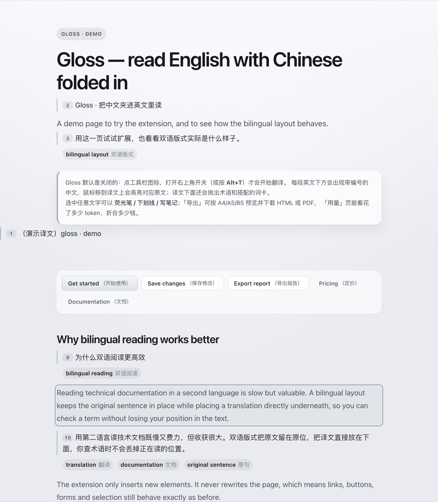
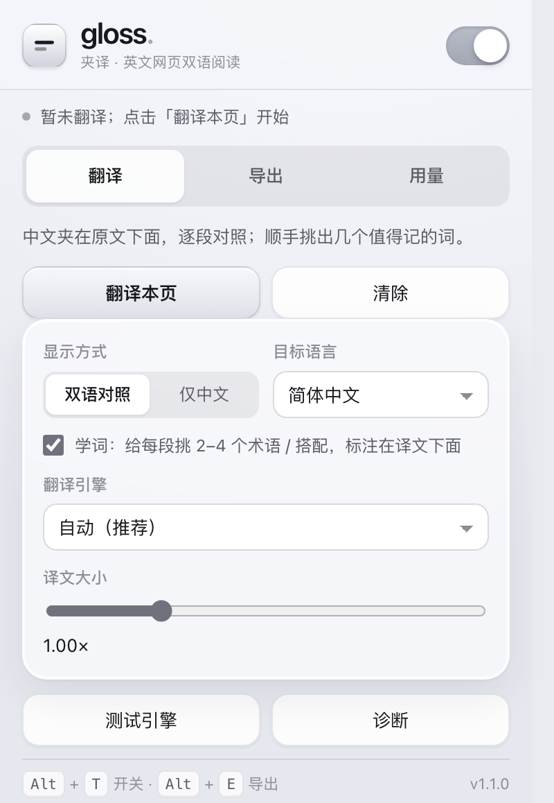
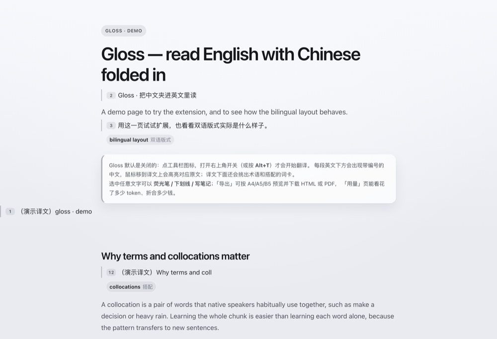
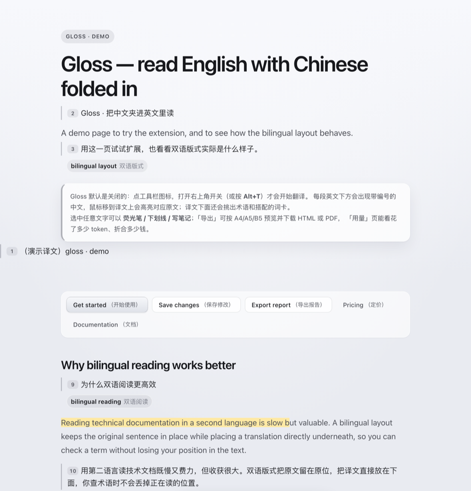
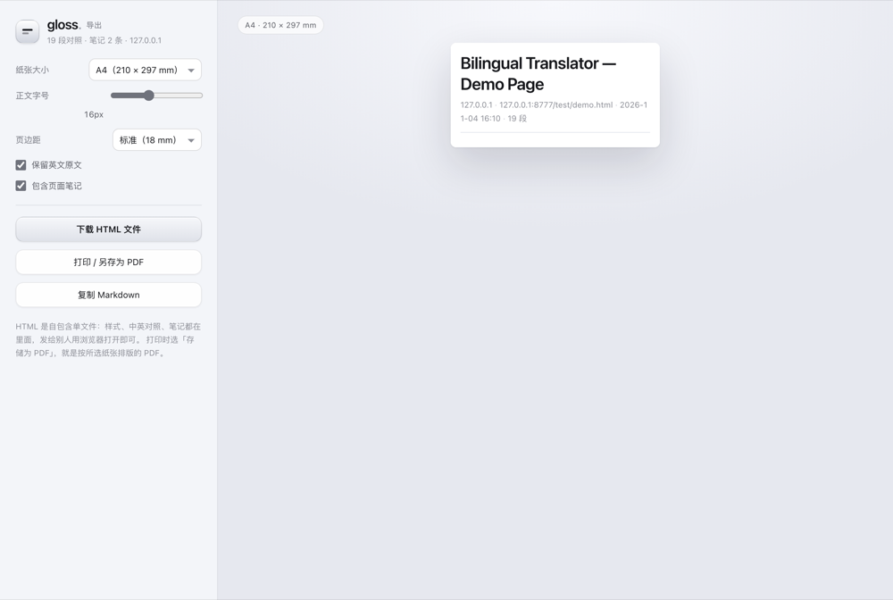
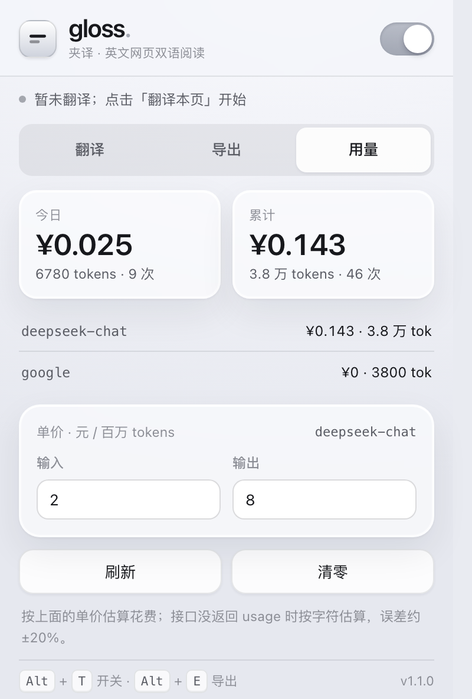

<div align="center">

# Gloss · 夹译

**读英文网页，像读一本双语书。**

把中文夹进原文下面，逐段编号对照；顺手挑出术语和搭配，可以划线做笔记，也能整页导出成 HTML / PDF。

<sub>Chrome 116+ · Manifest V3 · 默认关闭 · 笔记和用量只存在本地</sub>

**[📘 完整使用说明 → USAGE.md](USAGE.md)**（安装、快捷键、三种引擎、给 AI 的操作提示）

</div>



---

## 为什么做这个

读英文技术文档时，最累的不是生词，而是**回头**：查一个词，翻回上一句，再找回刚才读到哪儿。
把整页翻译会丢掉原文，把翻译放进侧边栏又得来回扫视。

Gloss 的做法很简单：**原文一个字节都不改**，只在每个段落后面插入一段带编号的中文。
读的时候眼睛不用离开原位，鼠标移到译文上，对应的英文会亮起一圈描边。

## 默认关闭，先说清楚

装好之后 Gloss **不会自动翻译任何页面**。必须由你手动打开：

- 点工具栏上的 **g** 图标 → 打开右上角开关，或
- 在页面上按 <kbd>Alt</kbd> + <kbd>T</kbd>

这样设计是刻意的：翻译会往页面里插入节点，也会消耗 token 和钱。这两件事都不应该在你没要求的时候发生。
关掉开关（或再按一次 <kbd>Alt</kbd> + <kbd>T</kbd>），插入的译文和批注会立刻从页面上撤掉，原文恢复原样。

## 三步开始

**1. 装上**

```bash
git clone https://github.com/sundy-song/gloss.git
cd gloss
```

或者直接下载 ZIP 解压。然后打开 `chrome://extensions` → 右上角打开「开发者模式」→「加载已解压的扩展程序」→ 选择这个目录。

**2. 打开**

打开任意英文网页，点工具栏上的 **g**，打开开关。第一次翻译会把这一页扫描一遍，逐段插入中文。

同一个面板里还能改目标语言（简中 / 繁中 / 日 / 韩 / 西 / 法 / 德 / 俄），以及关掉「学词」：



**3. 读**

鼠标停在某段译文上，对应英文会高亮；选中任意文字，会浮出批注工具条。

---

## 能做什么

### ① 逐段对照，不会串行

每段译文左侧有编号，和原文一一对应。插入时按「块级归属元素」整块处理，
所以原文里混着行内标签、链接、加粗，中文也不会被切碎或者跑到别的段落去。


### ② 学词：术语和搭配，顺手记住

译文下面会挑出这一段里值得记的词——缩写、术语、连字符复合词、形容词 + 名词的搭配——
每个都给中文，做成小卡片：**bilingual layout 双语版式**、**working memory 工作记忆**。

目的不是让你一直看中文，而是让你**以后不用看**：先靠译文过关，再靠这些词卡把原文读顺。
挑词是本地规则（`lib/terms.js`），只有词本身会被送去翻译，不额外消耗整段重翻的钱。



### ③ 划线、荧光笔、笔记

选中文字浮出工具条：三色荧光笔、下划线、写笔记、调译文大小。

批注**不再往正文里插节点**：高亮用浏览器的 [CSS Custom Highlight API](https://developer.mozilla.org/docs/Web/API/CSS_Custom_Highlight_API)
直接画在文字上，DOM 一个字节都不动，所以不会把页面撑变形、也不会打乱行内标签。
笔记显示为段落下方的一张卡片，按网址保存在本地，刷新后自动恢复。



### ④ 导出成 HTML / PDF / Markdown

按 <kbd>Alt</kbd> + <kbd>E</kbd> 打开导出页，或从弹窗「导出」进入。
左边选纸张（A4 / A5 / B5 / Letter）、字号、页边距，右边是按真实纸张比例排版的预览：

- **下载 HTML**：单文件、样式内联，发给别人用浏览器打开即可
- **打印 / 另存为 PDF**：按所选纸张分页
- **复制 Markdown**：贴到笔记软件或聊天窗口



### ⑤ 花了多少 token、多少钱

弹窗里的「用量」按模型统计今天和累计的请求次数、token 数、估算花费，
单价可以改（元 / 百万 tokens），改完历史金额会按新单价重算。学词产生的请求也计在里面。



> 以上截图由 `node test/docs/build-docs.mjs` 生成：真实页面、真实样式，只把 `chrome.*` 换成本地假实现。

---

## 目标语言

默认英文 → 简体中文，但不限于这一对。弹窗里的「目标语言」可选：

| 目标语言 | 说明 |
| --- | --- |
| 简体中文 / 繁體中文 | 默认，学词词卡最完整 |
| 日本語 / 한국어 | 自动跳过已经是假名的段落 |
| Español / Français / Deutsch | 拉丁字母互译，不做同文字判断 |
| Русский | 跳过西里尔字母段落 |

源语言不需要设置：交给引擎判断（Google 接口与自定义 API 都能自动识别）。

## 快捷键

| 按键 | 作用 |
| --- | --- |
| <kbd>Alt</kbd> + <kbd>T</kbd> | 开启 / 关闭当前页的双语翻译 |
| <kbd>Alt</kbd> + <kbd>Shift</kbd> + <kbd>T</kbd> | 重新扫描当前页（动态内容没跟上时用） |
| <kbd>Alt</kbd> + <kbd>E</kbd> | 打开导出页 |

快捷键可以在 `chrome://extensions/shortcuts` 里改。

## 翻译引擎怎么选

| 引擎 | 需要什么 | 速度 | 花钱 | 特点 |
| --- | --- | --- | --- | --- |
| **Chrome 内置模型** | Chrome 116+，首次要下载语言包（约 2GB） | 快 | 免费 | 离线，文字不出本机 |
| **Google 免费接口** | 能访问 `translate.googleapis.com` | 快 | 免费 | 不用配置，质量中规中矩 |
| **自定义 API** | 一个兼容 OpenAI 格式的 Key | 取决于服务 | 按量计费 | 国内可用，质量最好 |

默认是「自动」：能用内置模型就用内置，否则试 Google，都不行再看你有没有填 API Key。
设置页的「测试引擎」会实际翻一句话并告诉你用了哪个、耗时多少。

## 花费怎么估

```
花费 = 输入 tokens × 输入单价 + 输出 tokens × 输出单价
tokens 估算：中文 1 字 ≈ 1 token，英文 4 字符 ≈ 1 token
```

接口返回了 `usage` 就用真实数字；没返回就按字符估算，误差大约 ±20%。

内置的默认单价（元 / 百万 tokens，可在用量页改）：

| 模型 | 输入 | 输出 |
| --- | --- | --- |
| deepseek-chat | 2 | 8 |
| deepseek-reasoner | 4 | 16 |
| gpt-4o-mini | 1.1 | 4.4 |
| gpt-4o | 18 | 72 |
| qwen-plus | 0.8 | 2 |
| moonshot-v1-8k | 2 | 10 |

价格会变，以你填的为准。

## 隐私

- 不开开关，Gloss 什么都不做，也不会读页面内容
- 用 **Chrome 内置模型**时，页面文字不会离开本机
- 用 **Google / 自定义 API** 时，译文请求会带上**当前页面的文本**，只发给对应的服务商
- 批注和笔记存在 `chrome.storage.local`，按网址索引，不上传
- 用量统计只记录 token 数和模型名，不记录页面内容

## 已知限制

- 不翻译「已经是目标语言」的段落（比如目标是中文时跳过中文页）；源语言不猜，交给引擎
- 代码块、输入框、`contenteditable` 区域会被跳过（有意为之）
- 内置模型首次使用需要手动点一下下载语言包（Chrome 的安全策略），下载完就不用再管
- 极少数把正文拆成大量行内元素的站点，译文会退化成整块，观感一般
- 导出 HTML 使用系统字体，不内嵌中文字体
- 学词靠本地规则（缩写、后缀、专有名词、形容词 + 名词），英文源最准；其他源语言只能靠通用规则，偶尔会挑出不想要的词，可以在弹窗里关掉

## 目录结构

```
manifest.json            # MV3 清单
background.js            # service worker：翻译、用量记账、导出、快捷键
content.js               # 扫描页面、插入译文、清除、导出模型
annotate.js              # 批注：选中 → 工具条 → 高亮/下划线/笔记
content.css              # 注入页面的样式（译文、编号、批注）
popup.html/css/js        # 弹窗：翻译 / 导出 / 用量
export.html/css/js       # 导出页：纸张预览、下载、打印
lib/text.js              # 文本判定：哪些该翻、怎么切句
lib/pricing.js           # 单价表与 token 估算
lib/terms.js             # 学词：术语 / 搭配的本地挑选规则
lib/report.js            # 导出 HTML / Markdown 的模板
docs/img/                # README 截图
test/                    # 单元测试、验收页面、截图脚本
```

## 开发与验证

纯原生 JS，没有构建步骤，改完在 `chrome://extensions` 点一下刷新即可。

```bash
node test/text.test.mjs        # 文本判定与切句
node test/terms.test.mjs       # 学词：术语与搭配提取
node test/background.test.mjs  # 翻译调度、用量记账
node test/pricing.test.mjs     # token 估算与金额格式
node test/report.test.mjs      # 导出模板
node test/manifest.test.mjs    # 清单、图标、语法、资源引用
node test/docs/build-docs.mjs  # 重新生成 README 截图（无头 Chrome）
node scripts/pack.mjs          # 打包成 dist/gloss-<版本>.zip（发布用）
```

两个验收页面用无头 Chrome 打开，看 `document.documentElement` 上的 `data-*` 属性即可：

```bash
# 开关行为：默认 0 段译文；打开后开始翻译；关闭后清空
"/Applications/Google Chrome.app/Contents/MacOS/Google Chrome" --headless=new --dump-dom \
  --virtual-time-budget=12000 "file://$PWD/test/toggle.html" | grep -o 'data-toggle="[^"]*"'
```

## 关于名字

**Gloss** 在语言学里指「夹注、行间注解」：行与行之间补一句解释，原文不动。
中文名取「夹译」，也是同一件事——把译文夹在原文中间。

图标就是这件事的图形化：上面一条是原文，下面短一截、浅一档的是夹进去的译文。

视觉：冷灰底 + 半透明玻璃卡 + 灰阶点缀，圆角、细线、内高光；
字体全部走系统（macOS / iOS 是 SF Pro，Windows 是 Segoe UI，中文回落苹方 / 微软雅黑），不打包第三方字体，跟随系统深浅色。

## 仓库里有什么、没有什么

- **有**：扩展源码（原生 JS，无构建）、测试、演示页、README 截图
- **没有**：任何人的 API Key、token、浏览器数据、个人路径

API Key 只在你自己的浏览器 `chrome.storage.local` 里，从来没进过仓库。
`.gitignore` 也挡掉了 `*.crx`、`*.pem`、`dist/`、`docs/preview/` 这些本地产物。

## License

MIT
