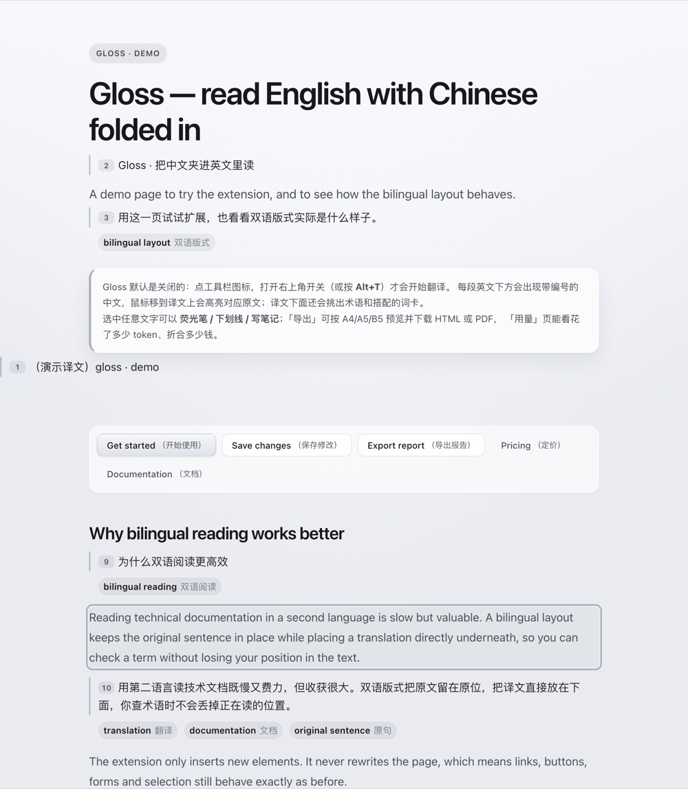
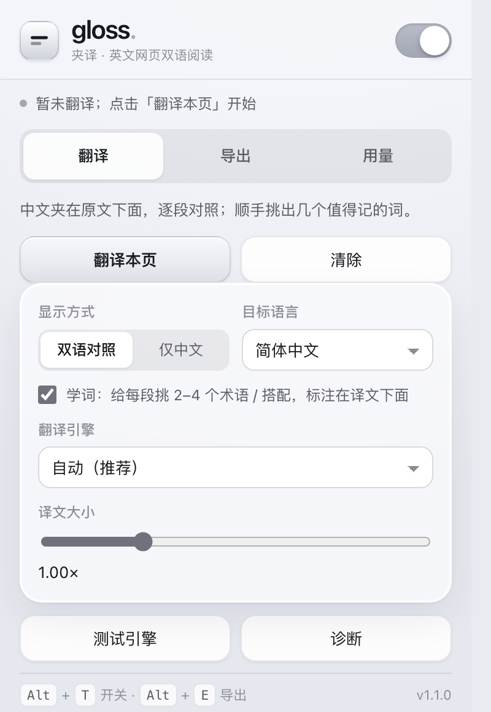
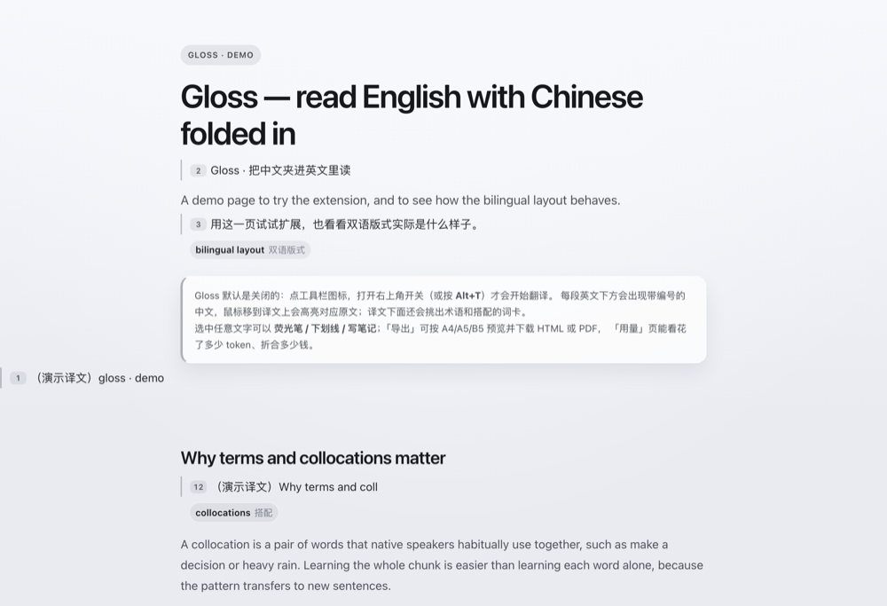
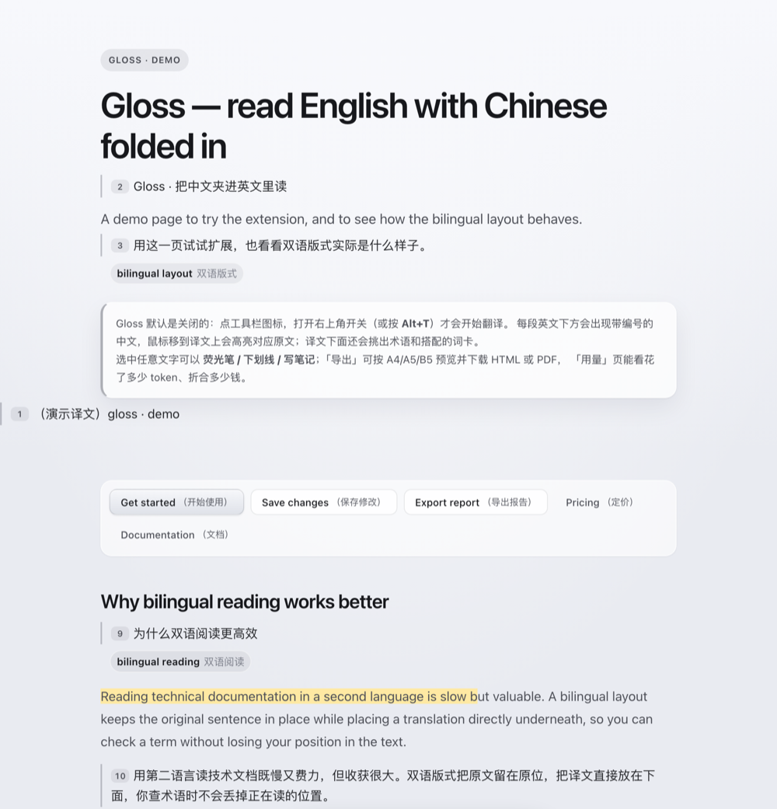
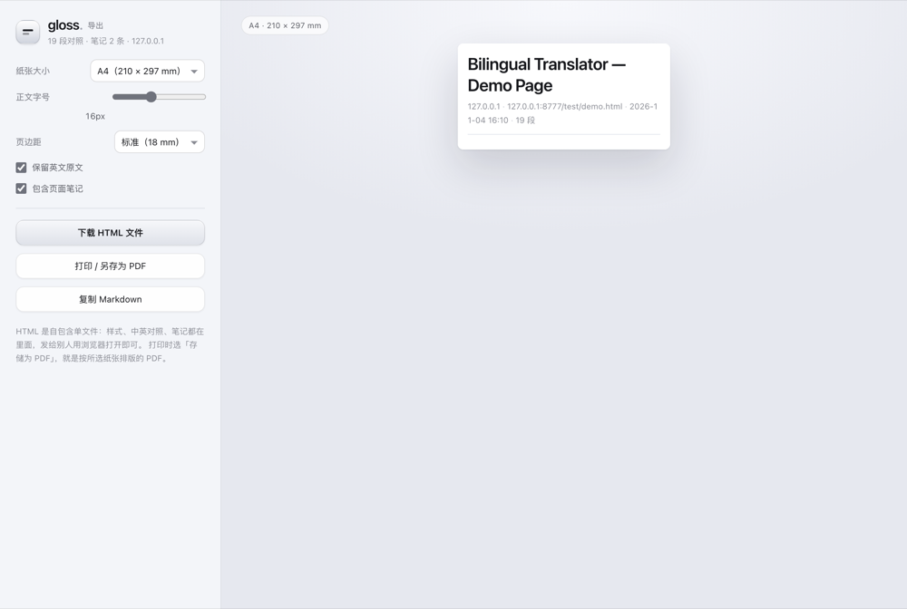
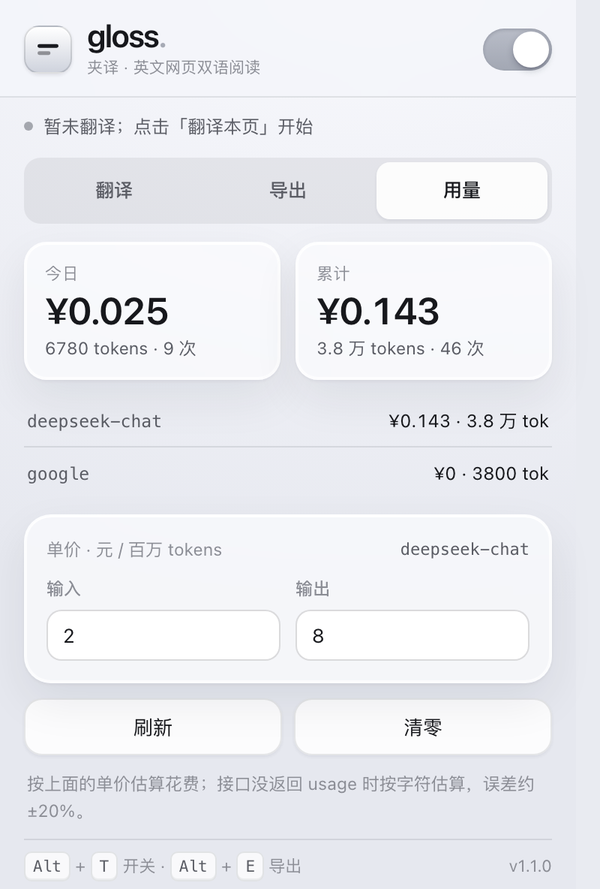

# Gloss 使用说明

> 版本 v1.3.0 · Chrome / Edge（Chromium 内核）· 默认关闭，用的时候才开

Gloss 把译文**逐段夹在原文下面**，原文一个字都不改。适合两种人：想读懂英文网页的人，和想借读原文把英语学起来的人。



---

## 目录

1. [安装](#一安装2-分钟)
2. [第一次翻译](#二第一次翻译30-秒)
3. [弹窗里每一项是什么](#三弹窗里每一项是什么)
4. [学词](#四学词译文下面那几个小药丸)
5. [划线、荧光笔、笔记](#五划线荧光笔笔记)
6. [导出成 HTML / PDF](#六导出成-html--pdf)
7. [用量与花费](#七用量与花费)
8. [用自己的 API](#八用自己的-api可选)
9. [隐私](#九隐私说明)
10. [常见问题](#十常见问题)
11. [让 AI 帮你](#十一让-ai-帮你最省事的方式)
12. [更新与卸载](#十二更新与卸载)

---

## 一、安装（2 分钟）

Gloss 没有上架 Chrome 应用商店，用「加载已解压的扩展程序」安装。这是开发者模式的正常用法，Chrome 会提示一次「开发者模式扩展」，属正常现象。

### 方式 A：下载压缩包（推荐给不写代码的人）

1. 打开项目主页的 **Releases**，下载最新的 `gloss-x.y.z.zip`
2. 解压，得到一个包含 `manifest.json` 的文件夹
3. 地址栏输入 `chrome://extensions` 回车
4. 打开右上角的 **开发者模式**
5. 点左上角 **加载已解压的扩展程序**，选中第 2 步那个文件夹（要选到 `manifest.json` 所在的那一层，不是它的上一层）
6. 装好后，点浏览器右上角的拼图图标，把 **Gloss** 钉在工具栏上

### 方式 B：命令行

```bash
git clone https://github.com/sundy-song/gloss.git
```

然后在 `chrome://extensions` 里「加载已解压的扩展程序」，选中 `gloss` 文件夹。

> Edge 同理：`edge://extensions` → 开发者模式 → 加载解压缩的扩展。

---

## 二、第一次翻译（30 秒）

1. 打开任意**英文**网页
2. 点工具栏上的 **Gloss** 图标
3. 打开右上角的开关（或者直接按 <kbd>Alt</kbd> + <kbd>T</kbd>）
4. 稍等几秒，每段英文下面会出现带编号的中文

**关掉开关**（再按一次 <kbd>Alt</kbd> + <kbd>T</kbd>，或点开关），插入的译文、词卡、笔记会立刻撤掉，页面恢复原样。

| 快捷键 | 作用 |
| --- | --- |
| <kbd>Alt</kbd> + <kbd>T</kbd> | 打开 / 关闭翻译 |
| <kbd>Alt</kbd> + <kbd>Shift</kbd> + <kbd>T</kbd> | 重新扫描当前页（改了设置或动态内容没跟上时用） |
| <kbd>Alt</kbd> + <kbd>E</kbd> | 打开导出页 |

快捷键冲突的话，去 `chrome://extensions/shortcuts` 改。

### 第一次用「Chrome 内置模型」会多一步

弹窗里引擎选「Chrome 内置模型（离线）」时，页面右下角会提示**需要下载语言包**。点提示里的「下载并启用」，等几十 MB 下载完，之后就一直离线可用，不用再下。

不想下载就选「Google 免费接口」，不需要任何配置。

---

## 三、弹窗里每一项是什么



| 位置 | 作用 | 建议 |
| --- | --- | --- |
| 右上角开关 | 总开关，关掉即撤掉所有插入内容 | 默认关，按需开 |
| 翻译本页 / 清除 | 立即扫描本页 / 清掉本页已插入的译文 | 页面很长时点「清除」再重翻 |
| 显示方式 | **双语对照**（原文 + 译文）/ **仅中文**（替换） | 想学英语选双语 |
| 目标语言 | 简中、繁中、日、韩、西、法、德、俄 | 默认简中 |
| 学词 | 每段挑 2–4 个术语 / 搭配，标注在译文下面 | 默认开；只想读不想学时关掉 |
| 翻译引擎 | 自动 / 内置 / Google / 自定义 API | 见下文 |
| 译文大小 | 译文相对原文的字号比例 | 觉得中文太挤就调大 |
| 测试引擎 / 诊断 | 检查当前引擎是否可用 | 翻译失败时先点它 |

**三种引擎怎么选：**

| 引擎 | 要联网 | 要花钱 | 适合谁 |
| --- | --- | --- | --- |
| Chrome 内置模型 | 首次要下载，之后离线 | 免费 | 注重隐私、不想配 Key |
| Google 免费接口 | 要 | 免费 | 最省事，先试这个 |
| 自定义 API | 要 | 看服务商 | 想用 DeepSeek / OpenAI / 本地 Ollama |

---

## 四、学词：译文下面那几个小药丸

每段译文下面会出现几个小标签，比如 **collocation 搭配**、**working memory 工作记忆**。

- 挑的是这段里的**术语**和**好搭配**（缩写、专有名词、连字符复合词、技术后缀、形容词 + 名词等）
- 每段 2–4 个，整页最多 12 个，同一个词只出现一次
- 想关掉：弹窗里的「学词」取消勾选，词卡会立刻消失且不再请求



> 挑词是本地规则，不额外花钱判断；只有被选中的词会去翻译，费用同样计入用量。

---

## 五、划线、荧光笔、笔记

1. 用鼠标选中任意一段文字（原文或译文都行）
2. 会浮出一条小工具条
3. 点三色圆点加荧光笔、点「下划线」、或点「笔记」写一段话



- 高亮是浏览器**直接画在文字上**的，不会改动页面结构，所以不会把排版挤乱
- 笔记会以一张卡片贴在对应段落下面，带「注」标签和删除按钮
- 批注按网址存在本机，刷新、重开浏览器都还在
- 选中已批注的文字，工具条里会出现「清除」

---

## 六、导出成 HTML / PDF

按 <kbd>Alt</kbd> + <kbd>E</kbd>，或弹窗「导出」页点「预览并导出」。

- 选纸张：A4 / A5 / B5 / Letter
- 调正文大小和页边距
- 勾选是否保留英文原文、是否带页面笔记
- 三种产出：
  - **下载 HTML 文件**：单文件，样式和内容都在里面，发给别人用浏览器打开即可
  - **打印 / 另存为 PDF**：在打印对话框选「存储为 PDF」
  - **复制 Markdown**：贴到 Notion、Obsidian 里



---

## 七、用量与花费

「用量」页显示今日和累计的 token 数与估算花费，按模型分别列出。

- 单价在下面可改（元 / 百万 tokens），按你实际用的服务商填
- 接口返回了 `usage` 就用真实数字；没返回就按字符估算，误差约 ±20%
- 「刷新」「清零」分别是重新统计和归零



> 用 Chrome 内置模型或 Google 免费接口时，费用一直是 0，这是正常的。

---

## 八、用自己的 API（可选）

支持任何 **OpenAI 兼容格式**的接口：DeepSeek、通义千问、Kimi、OpenAI、本地 Ollama 等。

1. 弹窗 → 引擎选 **自定义 API**
2. 填三项：

| 字段 | 例子 |
| --- | --- |
| API 地址 | `https://api.deepseek.com/v1`（Ollama：`http://localhost:11434/v1`） |
| API Key | 你的 Key（Ollama 随便填，如 `ollama`） |
| 模型 | `deepseek-chat` / `gpt-4o-mini` / `qwen2.5:7b` 等 |

3. 点「测试引擎」，看到成功提示即可
4. 回到页面按 <kbd>Alt</kbd> + <kbd>T</kbd> 开始翻译

**关于 Key 的安全：**

- Key 只保存在你自己浏览器的 `chrome.storage.local` 里，**不会上传、不会写进代码、不会进 Git 仓库**
- 换电脑、重装扩展要重新填
- 不要截图分享弹窗里的 Key；怀疑泄露就去服务商后台吊销重发
- 这个仓库里没有任何人的 Key，默认值是空的

---

## 九、隐私说明

- **默认关闭**：不开开关，Gloss 不扫描页面、不发任何请求
- **Chrome 内置模型**：页面文字不离开本机
- **Google / 自定义 API**：译文请求会带上当前页面的文本，只发给对应服务商
- **批注和笔记**：存在本机 `chrome.storage.local`，按网址索引，不上传
- **用量统计**：只记 token 数和模型名，不记录页面内容

---

## 十、常见问题

**点了开关没反应？**
先看页面右下角有没有提示。若提示「需要下载离线翻译包」，点「下载并启用」；若页面本身是中文，本来就没什么可翻的。

**一直显示「需要先下载离线翻译包」？**
Chrome 内置模型需要手动点一次下载（Chrome 的安全策略），浏览器要能访问 Google 的模型地址。下不动就换「Google 免费接口」。

**翻译到一半停了？**
点「测试引擎」看引擎是否可用；长页面会被限流，等几秒或点「清除」重来。

**中文和原文对不上 / 段落错位？**
Gloss 按块级元素归属，极少数把正文拆成大量行内元素的站点会退化成整块。遇到这种页面可以换「仅中文」模式，或把网址反馈到 Issues。

**会不会花钱？**
内置模型和 Google 接口免费。自定义 API 按服务商计费，弹窗里能看到估算。

**支持哪些语言？**
目标语言：简中、繁中、日、韩、西、法、德、俄。源语言不判断，交给引擎；已经是目标语言的段落会跳过。

**关掉开关会丢笔记吗？**
不会。插入的内容撤掉，记录留在本机，再打开会回来。

**怎么彻底删除数据？**
`chrome://extensions` → Gloss → 移除扩展，浏览器会清掉它的存储。

---

## 十一、让 AI 帮你（最省事的方式）

你的 AI 没法直接操作你的浏览器，但它可以照下面的说明一步步带你做。**复制整段，把最后一行换成你的情况**发过去即可。

### 11.1 安装 / 使用问题

```text
我在用 Gloss，一个开源的 Chrome 扩展（https://github.com/sundy-song/gloss）。
它把译文逐段夹在英文原文下面，默认关闭，点扩展图标或按 Alt+T 打开。

已知信息（不用再问我）：
- 这是 Manifest V3 扩展，没上架商店，只能「加载已解压的扩展程序」安装
- 安装路径：chrome://extensions → 开发者模式 → 加载已解压的扩展程序 → 选到 manifest.json 那一层
- 三种引擎：Chrome 内置（离线，首次要下载语言包）、Google 免费接口（免配置）、自定义 OpenAI 兼容 API（要 Base URL / Key / 模型名）
- 快捷键：Alt+T 开关，Alt+Shift+T 重新扫描，Alt+E 导出

请一步一步告诉我该怎么做，每一步都写清楚点哪里、输入什么；如果我卡住了，先问我看到了什么提示。

我的情况：<在这里写，例如「我装了但点开开关没反应」>
```

### 11.2 让 AI 帮你排查

```text
我按上面的方式装了 Gloss，现在遇到问题：<症状>。
我的环境：<macOS / Windows> + Chrome <版本>，引擎选的是 <内置 / Google / 自定义>。

请按这个顺序帮我排查，一次只让我做一步：
1. 扩展是否已启用、是否钉在工具栏
2. 打开 chrome://extensions 看有没有报错（点「错误」按钮）
3. 弹窗里点「诊断」，把结果告诉我
4. 换一个简单英文页面（比如 example.com）再看
5. 换一个引擎再试

需要我给截图或报错文本时，直接说。
```

### 11.3 让 AI 帮你改代码

```text
请帮我改 Gloss 这个 Chrome 扩展（仓库：https://github.com/sundy-song/gloss）。
它是原生 JS，没有构建步骤，改完在 chrome://extensions 点刷新即可生效。

代码结构：
- manifest.json：MV3 清单，content_scripts 顺序是 lib/text.js → lib/terms.js → content.js
- content.js：扫描页面、插入译文、学词
- annotate.js：批注（CSS Custom Highlight API，不修改 DOM）
- background.js：service worker，翻译调度、用量记账
- lib/terms.js：术语/搭配的本地挑选规则
- popup.*：设置面板；export.*：导出页

我的需求：<写清楚要改什么>
要求：不要引入构建步骤；不要往仓库里写任何 API Key；改完告诉我怎么验证。
```

---

## 十二、更新与卸载

**更新**：下载新版 ZIP 解压，覆盖原文件夹，然后到 `chrome://extensions` 点 Gloss 卡片上的刷新图标。

**卸载**：`chrome://extensions` → Gloss → 移除。本机的批注、笔记、用量会一并清除。

---

## 许可

MIT。欢迎提 Issue 和 PR。
